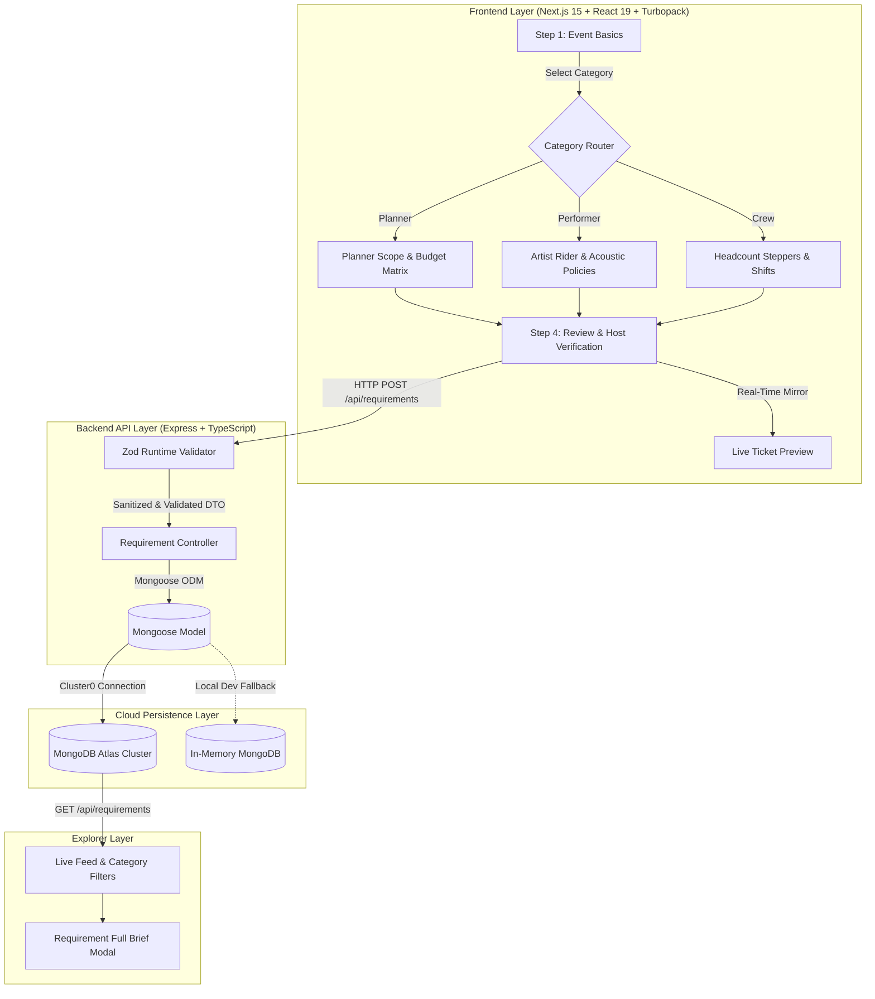

<div align="center">

# 🎪 GoPratle — Adaptive Event Requirement Platform

**An enterprise-grade, multi-stage event requirement intake and marketplace engine connecting event hosts with verified Planners, Performers, and Crew.**

[](https://nextjs.org/)
[](https://www.typescriptlang.org/)
[](https://nodejs.org/)
[](https://expressjs.com/)
[](https://cloud.mongodb.com/)
[](https://tailwindcss.com/)
[](https://zod.dev/)

[🌐 Live Web App (Vercel)](https://gopratle-requirement-k3mp.vercel.app/) • [📡 Live Backend API (Render)](https://gopratle-requirement.onrender.com/api/health) • [📋 API Documentation](#-api-specification) • [Architecture Decisions](#-architectural-highlights--design-patterns)

</div>

---

## 📌 Executive Summary

Modern event coordination requires wildly different data models depending on whether a host is hiring an **Event Planner** (budget ranges, guest counts, full decor scoping), a **Performer / Artist** (musical genres, set durations, technical PA rider policies), or **Event Crew & Staff** (role-specific headcount steppers, shift timings, uniforms).

Most marketplaces suffer from either **form bloat** (one massive form with dozens of irrelevant fields) or **schema pollution** (unstructured loose JSON blobs in the database).

**GoPratle** solves this with an **Adaptive Multi-Stage Intake Engine**:
1. **Dynamic Category Discrimination**: The wizard structurally morphs at Step 2 and Step 3 based on the category selected in Step 1.
2. **Zero-Latency Ticket Projection**: Real-time reactive preview mirrors form state as an event ticket with live barcode generation.
3. **Type-Safe Full-Stack Validation**: Unified TypeScript contracts validated by **Zod** at runtime and mapped directly to strict **Mongoose** subdocument schemas.
4. **Draft Resilience**: Client-side form persistence via `localStorage` prevents state loss on accidental reloads.

---

## 🏗️ Architecture & Data Flow



---

## 🎯 Key Features & Functional Flow

### 1. Step 1: Event Basics & Category Discriminator
* **Event Metadata**: Title, event format (Wedding, Concert, Corporate Gala, Private Party, College Fest).
* **Date Engine**: Single-day vs multi-day date range selector with automatic backwards-date prevention (`endDate >= startDate`).
* **Location & Venue**: City, State, and optional venue specification with quick-pick metro chips.
* **Category Card Selector**: Visual selection for **Event Planner**, **Performer / Artist**, or **Event Crew & Staff**.

### 2. Steps 2 & 3: Domain-Adaptive Intake
* **For Event Planners**:
  * Multi-select services: *Venue Sourcing, Decor Styling, Catering, Vendor Management, Day-of Coordination*.
  * Guest count and dual INR budget sliders (Min – Max Lakhs).
  * Theme styling, catering preferences (Pure Veg, Multi-Cuisine, Live Stations), and host vision notes.
* **For Performers / Artists**:
  * Performance format: *DJ, Live Band, Solo Vocalist, Acoustic Duo, Standup Comic, MC / Anchor*.
  * Genre multi-select: *Bollywood Commercial, EDM, Sufi Rock, Hip Hop, Punjabi Pop, Jazz*.
  * Set duration (hours), number of performance sets, sound/PA system ownership policy, and stage dimensions.
* **For Event Crew & Staff**:
  * Interactive role counter steppers: *Photographer, Videographer, Sound Technician, Light Operator, Bouncers, Stage Hands, Registration Desk*.
  * Real-time automated headcount aggregator.
  * Shift timing pickers, personal gear policy, meals provided toggle, and uniform/dress code requirements.

### 3. Step 4: Executive Review & Host Verification
* Collapsible, structured brief of all provided inputs.
* In-place "Edit" shortcuts allowing instant jumps back to Step 1, 2, or 3.
* Host identity capture (Full Name, verified Email, Indian mobile number).
* Single-click dispatch to MongoDB with confetti celebration and copyable MongoDB `_id`.

### 4. Live Marketplace Feed & Explorer
* Real-time document ingestion directly from MongoDB Atlas.
* Instant category pill filtering (`All`, `Planners`, `Performers`, `Crew`) with dynamic count badges.
* Multi-attribute live search across event names, cities, and types.
* **Full Brief Modal**: Comprehensive drawer view showing all host logistics and contact links.
* Test deletion capability to clean up sample submissions during evaluations.

---

## 🧠 Architectural Highlights & Design Patterns

### 1. Discriminated Subdocument Schema Pattern
Instead of polluting a single flat table with dozens of nullable columns or splitting requirements across 3 disjointed tables, we utilize a **Discriminated Subdocument Schema** in Mongoose:

```typescript
const RequirementSchema = new Schema({
  category: { type: String, enum: ['planner', 'performer', 'crew'], required: true },
  eventName: { type: String, required: true },
  eventType: { type: String, required: true },
  location: { ... },
  // Category-specific subdocuments populated conditionally
  plannerDetails: { type: PlannerDetailsSchema, required: false },
  performerDetails: { type: PerformerDetailsSchema, required: false },
  crewDetails: { type: CrewDetailsSchema, required: false },
  contact: { ... },
  status: { type: String, default: 'open' }
}, { timestamps: true });
```
**Advantage**: Ensures atomic indexing on shared fields (`createdAt`, `status`, `category`) while preserving strict typed subdocuments for category-specific queries.

### 2. Dual-Layer Validation (Zod + Mongoose)
* **Frontend**: Immediate user feedback with field-level checks before step advancement.
* **Backend**: Strict runtime parsing via Zod ensures that payloads cannot inject invalid dates, out-of-order budgets, or missing category details:
```typescript
// Example: Validates budgetMin <= budgetMax if both provided
.refine(data => !data.plannerDetails || data.plannerDetails.budgetMin <= data.plannerDetails.budgetMax, {
  message: "Minimum budget cannot exceed maximum budget"
})
```

### 3. Graceful Database Resilience
`backend/src/config/db.ts` automatically connects to **MongoDB Atlas Cloud**. If a developer clones the repository in an offline environment without an Atlas URI, it automatically falls back to an in-memory database (`mongodb-memory-server`), ensuring the app never crashes on local evaluation.

---

## 📡 API Specification

| Method | Endpoint | Description | Query / Body Params |
| :--- | :--- | :--- | :--- |
| `POST` | `/api/requirements` | Create a new categorized requirement | Full `IRequirementFormData` payload |
| `GET` | `/api/requirements` | Fetch requirements with filtering | `?category=planner&search=Jaipur&city=Jaipur` |
| `GET` | `/api/requirements/:id` | Fetch full requirement brief by ID | `id` route parameter |
| `GET` | `/api/requirements/stats/summary` | Get aggregated category counts | None |
| `DELETE` | `/api/requirements/:id` | Remove a requirement | `id` route parameter |

---

## 🗂️ Project Structure

```bash
gopratle-requirement-flow/
├── backend/
│   ├── src/
│   │   ├── config/
│   │   │   └── db.ts                   # MongoDB Atlas connection & in-memory fallback
│   │   ├── controllers/
│   │   │   └── requirementController.ts# Express route handlers
│   │   ├── models/
│   │   │   └── Requirement.ts          # Mongoose schema with discriminated subdocuments
│   │   ├── routes/
│   │   │   └── requirementRoutes.ts    # REST routing
│   │   ├── validations/
│   │   │   └── requirementValidation.ts# Zod schemas for payload validation
│   │   ├── scripts/
│   │   │   └── seed.ts                 # Database seed script with realistic event data
│   │   └── server.ts                   # Express server configuration
│   ├── package.json
│   └── tsconfig.json
│
├── frontend/
│   ├── src/
│   │   ├── app/
│   │   │   ├── layout.tsx              # Root HTML & Google font loading
│   │   │   ├── page.tsx                # Master orchestration page & draft hydration
│   │   │   └── globals.css             # Radiant mesh gradients & glassmorphism utilities
│   │   ├── components/
│   │   │   ├── Navbar.tsx              # Brand header, theme toggle & 1-click sample presets
│   │   │   ├── HeroBanner.tsx          # Dribbble sunset header with metric badges
│   │   │   ├── wizard/
│   │   │   │   ├── Stepper.tsx         # Responsive progress indicator
│   │   │   │   ├── EventBasics.tsx     # Step 1: Core event inputs & category selection
│   │   │   │   ├── CategoryDetails.tsx # Step 2: Dynamic domain-specific form
│   │   │   │   ├── EventLogistics.tsx  # Step 3: Logistics, sound policy & shift timings
│   │   │   │   ├── ReviewSummary.tsx   # Step 4: Executive review & host contact
│   │   │   │   ├── EventPreviewCard.tsx# Live reactive ticket preview
│   │   │   │   └── SubmissionSuccess.tsx# Confetti success modal
│   │   │   └── feed/
│   │   │       ├── RequirementFeed.tsx # Real-time marketplace feed & filters
│   │   │       └── RequirementDetailModal.tsx # Full brief modal
│   │   ├── lib/
│   │   │   ├── api.ts                  # Type-safe API client
│   │   │   ├── constants.ts            # Centralized domain options & sample presets
│   │   │   └── styles.ts               # Shared DRY styling helpers
│   │   └── types/
│   │       └── requirement.ts          # Shared TypeScript interfaces
│   ├── package.json
│   └── tsconfig.json
│
└── README.md
```

---

## 🚀 Getting Started

### Prerequisites
* **Node.js**: v18.0.0 or higher
* **npm**: v9.0.0 or higher
* **MongoDB**: A free MongoDB Atlas cluster URI (optional, falls back to in-memory)

### 1. Clone the Repository
```bash
git clone https://github.com/sanskritig007/gopratle-requirement.git
cd gopratle-requirement
```

### 2. Backend Setup
```bash
cd backend
npm install

# Create environment file
cat <<EOF > .env
PORT=5001
MONGODB_URI=your_mongodb_atlas_connection_string
CORS_ORIGIN=http://localhost:3000
NODE_ENV=development
EOF

# Seed initial test data (Optional)
npm run seed

# Start Express server
npm run dev
```
Backend will be live at `http://localhost:5001`.

### 3. Frontend Setup
```bash
cd ../frontend
npm install

# Start Next.js development server
npm run dev
```
Frontend will be live at `http://localhost:3000`.

---

## 🛡️ Edge Cases Handled

1. **Chronological Invariance**: End date cannot be set before start date; single-day vs range toggle clears stale dates.
2. **Category Switching Safety**: If a host switches from *Planner* to *Crew*, invalid nested states are cleanly quarantined.
3. **Crew Zero-Headcount Guard**: Prevents submission of a crew requirement with 0 members.
4. **Draft Recovery**: Auto-saves every keystroke to `localStorage`; automatically clears on verified MongoDB submission.
5. **Theme Persistence**: Preserves dark/light mode preference across browser sessions without UI flashing.

---

## 🔮 Future Roadmap

* [ ] **Host & Vendor Authentication**: NextAuth / JWT integration with role-based dashboard views.
* [ ] **Vendor Quotation Bidding**: Enabling registered planners/artists to submit formal bids directly on requirements.
* [ ] **Automated WhatsApp / Email Alerts**: Instant webhook notifications to relevant vendors when a matching requirement is posted in their city.
* [ ] **AI Scope Generator**: LLM-assisted requirement breakdown based on freeform host event descriptions.

---

<div align="center">

Built with ❤️ by **Sanskriti Goswami** for **GoPratle**

</div>
